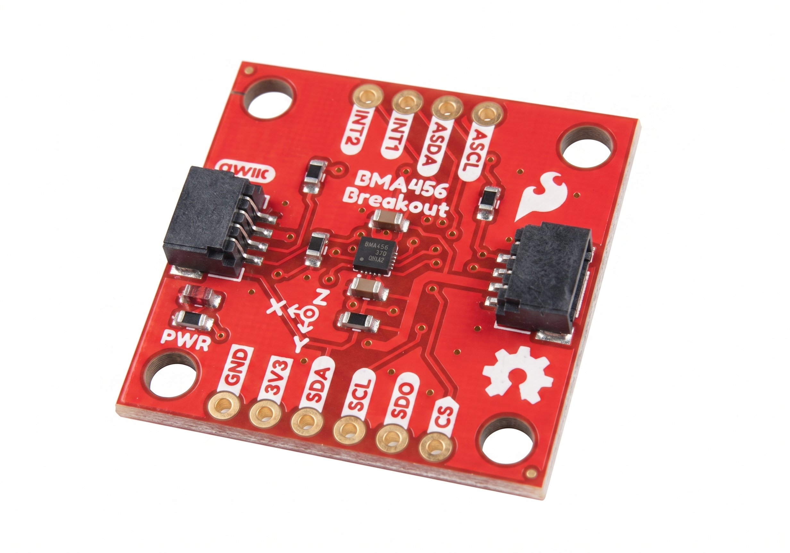

# SparkFun Triple Axis Accelerometer Breakout - BMA456 (Qwiic)

The SparkFun Triple Axis Accelerometer Breakout - BMA456 is a compact, plug-and-play motion sensing board built around the Bosch Sensortec BMA456, a 16-bit digital triaxial accelerometer with an on-chip feature engine for motion-triggered interrupts. Connect via the Qwiic connector or the PTH header and start reading acceleration over I2C in minutes, no external components required.

The BMA456 offers user-selectable measurement ranges of ±2g, ±4g, ±8g, and ±16g, low-pass filter bandwidths from 684Hz down to under 8Hz, and output data readout up to 1.6kHz. A 1kb on-chip FIFO buffers samples so your microcontroller does not have to poll continuously, and two configurable interrupt pins (INT1 and INT2) let the sensor wake your system only when something actually happens. The on-chip feature engine handles motion-triggered events in hardware, including any-motion and no-motion detection, single and double tap, tilt, orientation, and step counting, freeing your processor to sleep the rest of the time.

Designed for our [Qwiic ecosystem](https://www.sparkfun.com/qwiic), this 1" × 1" board plugs straight into any Qwiic-enabled microcontroller. An address jumper selects between I2C addresses 0x18 and 0x19 so you can put two of these on the same bus, and the PTH header breaks out the full SPI interface alongside I2C for applications that need a faster or dedicated connection. A power LED confirms operation at a glance, and the four mounting holes make permanent installation straightforward. Whether you are building a wearable activity tracker, adding tap-to-wake to a battery powered project, measuring tilt angle, or logging vibration and orientation, the BMA456 delivers low-power motion sensing in a breadboard-friendly package.

## Features

* Bosch Sensortec BMA456 16-bit triaxial accelerometer
* Selectable ranges: ±2g / ±4g / ±8g / ±16g
* Output data readout up to 1.6kHz
* Low-pass filter bandwidths from 684Hz to under 8Hz
* 1kb on-chip FIFO
* On-chip feature engine: any-motion, no-motion, single and double tap, tilt, orientation, step counter
* Two configurable interrupt pins (INT1, INT2)
* I2C and SPI (4-wire and 3-wire) interfaces
* Selectable I2C addresses: 0x18 (default) / 0x19
* 3.3V operation via Qwiic, IO supply range 1.2V to 3.6V
* Ultra-low power operation
* Two Qwiic connectors and a 0.1" PTH header
* 1.0" × 1.0" with four mounting holes

## Repository Contents

* **/docs** - Documentation files for GitHub pages
* **/Documents** - Datasheets, additional product information
* **/Hardware** - KiCad design files (.kicad_sch, .kicad_pcb)
* **/Production** - Production panel files

## Documentation

* **[Library](https://github.com/sparkfun/SparkFun_BMA456_Arduino_Library)** - Arduino library for the SparkFun Triple Axis Accelerometer Breakout - BMA456.
* **[Hookup Guide](https://docs.sparkfun.com/SparkFun_Triple_Axis_Accelerometer_Breakout_BMA456/)** - Basic hookup guide for the SparkFun Triple Axis Accelerometer Breakout - BMA456.

## Product Versions

* **[SEN-XXXXX](https://www.sparkfun.com/products/XXXXX)** - Initial release of the SparkFun Triple Axis Accelerometer Breakout - BMA456.

## License Information

This product is _**open source**_!

Please review the LICENSE.md file for license information.

If you have any questions or concerns about licensing, please contact technical support on our [SparkFun forums](https://forum.sparkfun.com/viewforum.php?f=152).

Distributed as-is; no warranty is given.

_- Your friends at SparkFun._
